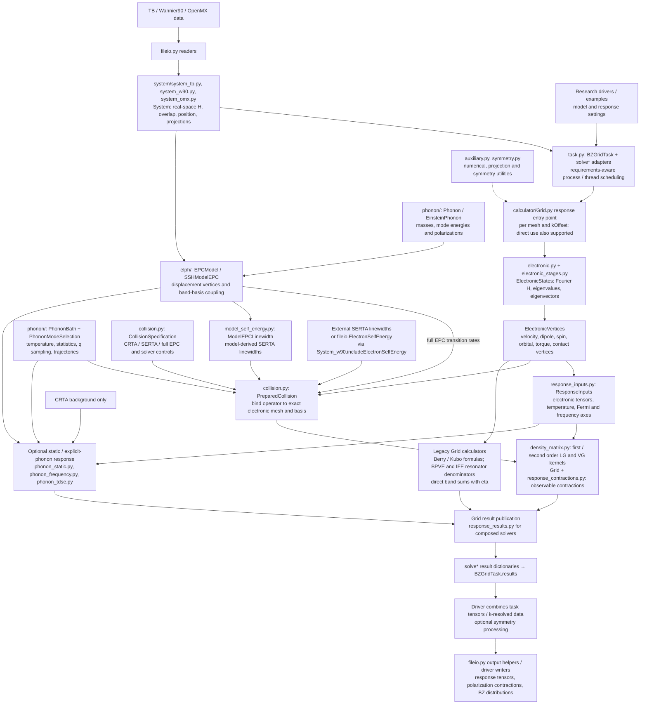
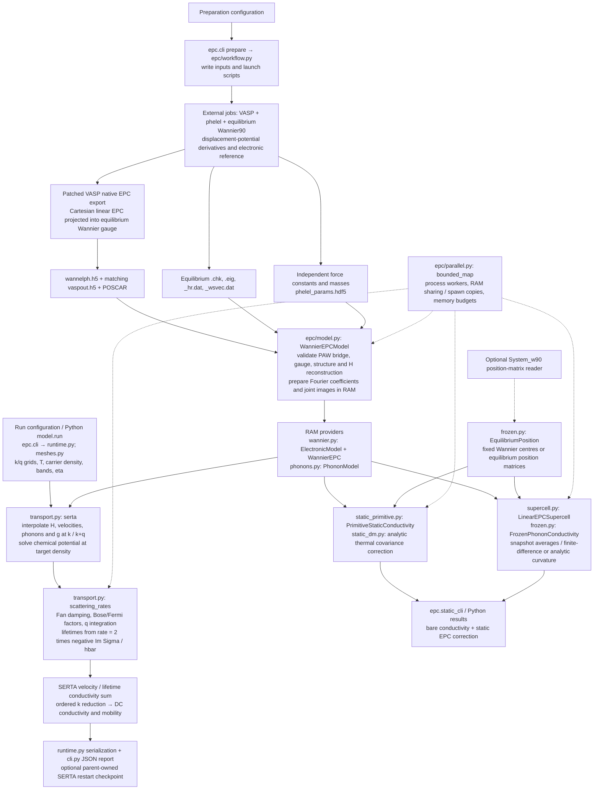

# Response workflow architectures

Source inspection: 2026-10-12. These diagrams describe the current checkout,
including the currently untracked `epc/` package. Solid arrows carry data or
call the next stage; dotted arrows indicate supporting services or optional
connections. External DFT jobs are distinct from Python input preparation.

## 1. Electronic System → Grid response architecture

### Reading the architecture

- `Grid.py` is the public response layer. Modern response classes compose
  electronic stages through `response_stages.py`; legacy classes still use
  stage inheritance. Both share the electronic stage implementation.
- A response can prepare its electronic data itself or reuse explicit
  `ElectronicStates`, `ElectronicVertices`, and `PreparedCollision` objects.
  Reuse requires the same model, mesh, offset and band basis.
- The DM path contracts response density matrices with observable vertices.
  First-order responses expose I/E channels; second-order responses expose
  II/EI/IE/EE channels where supported. Examples include optical conductivity,
  Hall/galvanic responses, BPVE, IFE and IFT.
- The legacy path bypasses the DM kernels and prepared collision layer.
  Explicit examples are `BulkPhotovoltaicEffect_VG`,
  `InverseFaradayEffect_LG`, and `InverseFaradayEffect_VG`; their broadened
  resonator denominators are implemented inside `Grid.py`.
- CRTA and SERTA collision operators are local linewidth operators. Full EPC
  includes scattering-in and couples populations across the electronic mesh.
  Full EPC and covariant linewidth derivatives require one complete mesh,
  disabling independent shifted-submesh workers in `BZGridTask`.
- Static/explicit-phonon solvers include coupling directly and accept a CRTA
  background only. There is also an electronic TDSE conductivity path in
  `tdse_response.py`, selected by `Opticalconductivity_TDSE`; it supports local
  CRTA/SERTA relaxation, while its explicit-phonon option uses CRTA only.
- `task.py` provides scheduling, adapters and mesh/symmetry helpers. General
  numerical utilities primarily live in `auxiliary.py`. `BZGridTask` collects
  results; the calling driver performs the final cross-task reduction.

### Source anchors

| Architectural responsibility | Source |
| --- | --- |
| System implementations | [TB](../system/system_tb.py), [Wannier90](../system/system_w90.py), [OpenMX](../system/system_omx.py) |
| Mesh scheduling and response adapters | [task.py](../task.py), [requirements.py](../calculator/requirements.py) |
| Electronic preparation | [electronic.py](../calculator/electronic.py), [electronic_stages.py](../calculator/electronic_stages.py) |
| Response composition and public calculators | [response_stages.py](../calculator/response_stages.py), [Grid.py](../calculator/Grid.py) |
| Collision operators | [collision.py](../calculator/collision.py), [model_self_energy.py](../calculator/model_self_energy.py) |
| DM kernels and contractions | [density_matrix.py](../calculator/density_matrix.py), [response_contractions.py](../calculator/response_contractions.py) |
| Physical phonons and coupling | [phonon exports](../phonon/__init__.py), [EPCModel](../elph/base.py), [SSHModelEPC](../elph/ssh.py) |
| Result publication and I/O | [response_results.py](../calculator/response_results.py), [fileio.py](../fileio.py) |
| Example of driver-owned averaging | [spinHallCondInput.py](../spinHallCondInput.py) |

## 2. VASP potential → Wannier EPC → conductivity architecture

### Reading the architecture

- `prepare_workflow` generates inputs and scripts; it does not run VASP,
  phelel or Wannier90. External jobs produce the derivative potential and
  equilibrium reference; patched VASP exports `wannelph.h5`.
- `WannierEPCModel` constructs and retains the electronic, Cartesian EPC and
  phonon providers in RAM. HDF5 handles close before response calculations.
  Source meshes and interpolated transport meshes are separate.
- The main transport branch is secular SERTA: compute on-shell Fan damping,
  convert it to scattering rates/lifetimes, and integrate the velocity-weighted
  conductivity. It does not invoke `calculator/Grid.py`,
  `calculator/density_matrix.py`, or `calculator/collision.py`.
- The static branch does use DM algebra, but its kernel is the independent
  `epc/static_dm.py`. It computes a quasistatic covariance correction using a
  positive background linewidth; it adds no separate EPC collision operator.
  The supercell branch supports snapshot averaging and curvature checks.
- Static calculations require an explicit equilibrium position choice.
  `epc.static_cli` can obtain it from `System_w90`, which is the optional bridge
  to the first architecture. This does not route the response through Grid.
- Parallel execution and result I/O belong to `epc/parallel.py`, `runtime.py`,
  `cli.py` and `static_cli.py`, rather than the main workflow's `task.py` and
  `fileio.py` output helpers.
- A separate `renormalize` command computes Fan plus explicitly contracted
  RIA Debye-Waller band-edge shifts through `self_energy.py`. It is a side
  calculation, not an obligatory stage before conductivity. A general
  displacement Hessian is not supplied by the linear EPC model.

### Source anchors

| Architectural responsibility | Source |
| --- | --- |
| External workflow input generation | [workflow.py](../epc/workflow.py), [cli.py](../epc/cli.py) |
| Source validation and RAM model | [model.py](../epc/model.py), [compact.py](../epc/compact.py), [vasp.py](../epc/vasp.py), [inputs.py](../epc/inputs.py) |
| Interpolated electrons and EPC | [wannier.py](../epc/wannier.py) |
| Force constants and phonons | [phonons.py](../epc/phonons.py) |
| Rates, chemical potential, conductivity and mobility | [transport.py](../epc/transport.py) |
| Execution, checkpoints and process scheduling | [runtime.py](../epc/runtime.py), [parallel.py](../epc/parallel.py) |
| Static primitive conductivity and DM kernel | [static_primitive.py](../epc/static_primitive.py), [static_dm.py](../epc/static_dm.py) |
| Frozen supercell response and position bridge | [supercell.py](../epc/supercell.py), [frozen.py](../epc/frozen.py), [static_cli.py](../epc/static_cli.py) |

## Boundary between the architectures

| Layer | System / Grid workflow | VASP potential / epc workflow |
| --- | --- | --- |
| Electronic model | `system.System` subclasses | `epc.WannierEPCModel.electrons` |
| Phonons | `phonon.Phonon` and `PhononBath` | `epc.phonons.PhononModel` |
| EPC provider | `elph.EPCModel` / SSH | `epc.wannier.WannierEPC` |
| Relaxation / scattering | Prepared CRTA, SERTA or full EPC collision operators | Direct Fan-rate SERTA; separate static response background |
| Response kernels | Shared calculator DM kernels, legacy formulas, TDSE | `transport.serta`, plus independent static DM / frozen solvers |
| Scheduling | `task.BZGridTask`, `solve*` adapters | `epc.parallel.bounded_map` |
| Result I/O | Driver reduction and `fileio` helpers | EPC runtime / CLI JSON reports |

The integration upgrade adds `elph.VaspWannierEPC` and
`phonon.ForceConstantPhonon` adapters. `System_w90.fromEPCReference` preserves
the EPC source's validated Hamiltonian/gauge, while `calculator.EPCLinewidth`
and the full EPC collision feed the main DM response calculators. The separate
EPC transport/static tools remain available. See
[VASP EPC in the main workflow](../examples/README_vasp_epc.md).
