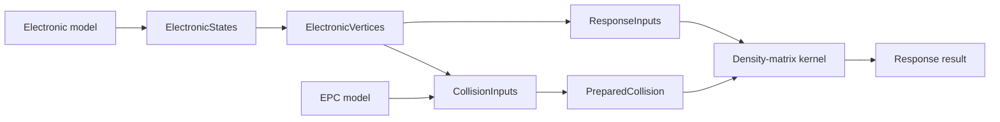

# Electronic preparation and explicit response inputs

The density-matrix workflow composes three computations: electronic preparation,
collision preparation, and response solving. Response classes in `Grid.py` select
their electronic stages explicitly; they do not inherit Energy, Velocity, or a
collision-preparation mixin.

```python
from calculator import (
    compute_states, compute_vertices, prepare_collision, CollisionSpecification,
    Opticalconductivity_LG_DM, Opticalconductivity_VG_DM,
)

# model and epc are the independent physical models described in README_epc_models.md.
states = compute_states(model, (16, 16, 1), kOffset=(0., 0., 0.))
electronic = compute_vertices(states, highOrderVelocity=True)
spec = CollisionSpecification('epc', qgrid=(4, 4, 1),
    phononTemperature=300., constantLinewidth=.2, delta=.03)
prepared = prepare_collision(electronic, spec, kBT=.0258519998, epc_model=epc)

lg = Opticalconductivity_LG_DM(preparedCollision=prepared,
    fermiList=[-.7], omegaList=[.5, .8])
vg = Opticalconductivity_VG_DM(preparedCollision=prepared,
    fermiList=[-.7], omegaList=[.5, .8])
assert lg.states is vg.states is states
assert lg.collision is vg.collision
```

`ElectronicStates` owns the prepared mesh, eigenvalues and eigenvectors.
`ElectronicVertices` references those states and carries velocity and any prepared
additional electronic tensors. Preparing high-order velocity above supplies the
contact vertices needed by VG. If a response requires additional vertices, it
constructs them using the same states, without another diagonalization. Compatible
velocity tensors are reused without another FFT. `Energy(...).states` and
`Velocity(...).electronic` expose the same result types for stage-oriented use.

Automatic preparation remains available by passing `model`, `kgrid`, and a
`collisionSpecification` to a response. Alternatively, pass `electronic=electronic`
with a specification to reuse electronic preparation while choosing a new collision.
`states=states` reuses the eigensystem and computes response-specific vertices.

A supplied `preparedCollision` already retains its electronic preparation and
electronic temperature. These are used when the caller omits them. Explicit model,
mesh, offset, or temperature arguments must agree. An independently diagonalized
mesh cannot bind to this collision merely because its dimensions agree: reuse
requires the identical `ElectronicStates` object, preserving the actual band gauge.
There is no Hamiltonian fingerprint or automatic mutation monitoring. Treat the
models and prepared arrays as unchanged throughout their calculation lifetime.



`ResponseInputs(electronic, kBT=..., fermiList=..., omegaList=...)` contains
electronic tensors and numerical settings, plus electronic algebra needed by
kernels. It holds no conductivity outputs. Kernels receive this object and an
explicit `collision` operator, and return density-matrix blocks. First-order
contraction functions return `FirstOrderResponseResult`, including raw BZ channel
sums, selected integrands, record indices and the kernel. Grid entry points apply
observable units and expose the usual `sigma` and channel arrays.

The static, frequency-domain phonon, phonon-TDSE, and electronic-TDSE solvers return
`ConductivityResult` containing conductivity, available channel decompositions,
sampling uncertainty and solver diagnostics. They do not modify the supplied
`ResponseInputs`. For example:

```python
from calculator import ResponseInputs
from calculator.collision import prepare_phonon_background
from calculator.phonon_static import solve_static_epc_conductivity

inputs = ResponseInputs(electronic, kBT=.0258519998,
    fermiList=[-.7], omegaList=[.8])
background = prepare_phonon_background(electronic,
    CollisionSpecification('crta', constantLinewidth=.2),
    kBT=inputs.kBT, epc_model=epc)
result = solve_static_epc_conductivity(inputs, 300., 'quantum', True,
    None, 4, epc_model=epc, collision=background)
sigma = result.sigma
```

The corresponding Grid classes publish the returned object as `result` and expose
its arrays for the task and I/O interfaces. Static and explicit-phonon response
still use a separate CRTA-background branch, with no EPC Markov collision.

`ModelEPCLinewidth` passes the prepared electronic states into self-energy.
Intermediate k+q points already on that mesh are indexed directly. Only off-mesh
intermediate points require an additional path eigensolve.

Implementation boundaries:

| Module | Responsibility |
|---|---|
| `electronic.py` | Electronic result types and preparation functions |
| `electronic_stages.py` | Electronic stage implementations |
| `electronic_algebra.py` | Occupations and band/dipole algebra |
| `response_stages.py` | Explicit composition for response entry points |
| `response_inputs.py` | Inputs consumed by density-matrix and phonon solvers |
| `response_results.py` | Returned solver results |
| `collision.py` | Collision preparation and operators |
| `phonon_*.py`, `tdse_response.py` | Independent response solvers |
| `Grid.py` | Response entry points and observable contractions |

Prepared electronic data, like prepared collisions, belongs to one exact mesh.
`BZGridTask` accepts it only for a single matching task. Independent shifted
submeshes prepare their own states within each worker. Full EPC still uses one
complete coupled mesh; this refactor does not change the parallel algorithm.
