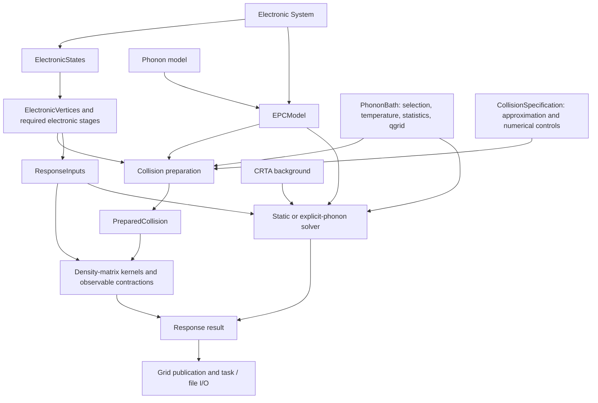

# Main workflow: physical models, preparation and response

This describes the `system → calculator/Grid.py` workflow. The separate `epc/`
workflow is not part of these interfaces.



## One phonon bath shared between calculations

`Phonon` contains masses, mode energies and displacement polarizations.
`PhononBath` contains calculation-specific occupations and sampling. There is no
model-owned `modeSelection` or automatic selection fallback. Selection weights
are absolute; a selected quadrature supersedes the auxiliary uniform qgrid.

```python
from phonon import PhononBath, PhononModeSelection
from calculator import CollisionSpecification, ModelEPCLinewidth

bath = PhononBath(temperature=300., statistics='quantum', qgrid=(8, 1, 1),
                 selection=PhononModeSelection([[.25, 0, 0]], branches=[1], weights=[.125]))
collision = CollisionSpecification('epc', phononBath=bath,
                                   delta=.03, constantLinewidth=.2)
linewidth = ModelEPCLinewidth(epc, phononBath=bath, fermi=-.7, delta=.03)
snapshots = bath.sampleDisplacements(supercell_epc.phonon_model, nSamples=8, seed=2026)
```

Static and explicit-phonon Grid constructors also accept `phononBath=bath`.
Static covariance supports quantum, classical and Wigner statistics. Real
trajectories support classical or Wigner statistics; a Wigner trajectory is
symmetrized quantum noise, not a quantum emission/absorption bath. To compare a
quantum calculation with that approximation, explicitly use
`replace(bath, statistics='wigner')`. Broadening, background relaxation and
linear-solver settings remain in `CollisionSpecification`.

The bath's `qgrid` controls rate/self-energy quadrature. Unrestricted real-space
sampling uses the supplied supercell's modes. Choose a matching supercell when
comparing those calculations; an explicit selection must be commensurate with it.

## Scheduling follows numerical requirements

`CollisionSpecification.requirements` declares whether a complete electronic
mesh is required. Full EPC and covariant linewidth derivatives require it;
ordinary CRTA/SERTA allow independent shifted submeshes. `BZGridTask` combines
these requirements with any explicit response requirement before preparing data.

```python
from calculator import ComputationRequirements
from task import BZGridTask

task = BZGridTask(model, task_function, arguments, BZGrid=(16, 16, 1),
    requirements=ComputationRequirements(requires_full_mesh=True))
```

Prepared electronic/collision data has a separate exact-mesh and basis binding.
A local prepared collision can be used with one matching full-mesh task; it does
not become a coupled collision. Submesh workers prepare their own data. This
does not implement a distributed full-EPC solve or concurrent collision reuse.

## Declared tensors and returned nonlinear results

`ElectronicVertices` declares its optional tensors as dataclass fields.
`ResponseInputs` and Grid entry points expose read-only properties referring to
those fields. Kernels declare required tensors through `electronic.require(...)`;
there is no dynamic dictionary injection of electronic fields into a solver.

`response_contractions.py` provides `solve_bpve_lg/vg`, `solve_ife_lg/vg` and
`solve_torque_lg/vg`. Each receives `ResponseInputs`, an explicit collision
operator and response options, and returns `SecondOrderResponseResult`:

- `value` and `channels`: BZ-averaged response and II/EI/IE/EE decomposition.
- `projected_value` and `projected_channels`: observable projection axes.
- `integrands` and `integrand_channels`: selected k-resolved responses.
- `fermi_indices`, `omega_indices`, `kernel` and channel descriptions.

Grid selects electronic stages and torque contact vertices before calling these
functions, then publishes the returned arrays under observable names. Numerical
contractions do not prepare models or write outputs into their inputs. The
legacy Berry-curvature/AHC stage inheritance remains unchanged.
