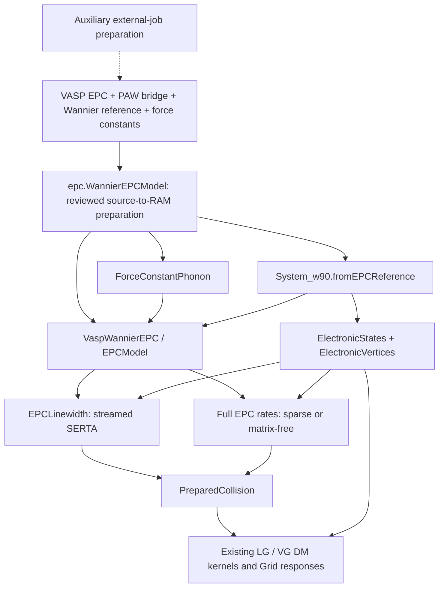

# VASP EPC in the main System / Grid workflow

The main workflow now accepts VASP-derived **linear** EPC through
`elph.VaspWannierEPC`. It reuses the existing reviewed `epc` source loader and
joint-image interpolation, then supplies the main collision operators and DM
response calculators. External input preparation and launch scripts remain in
`epc.workflow` / `epc.cli prepare`. Existing EPC transport, static/frozen and
RIA self-energy tools remain available as auxiliary calculations and oracles.



## Inputs and the electronic reference

Prepare one matching source bundle: `wannelph.h5`, PAW bridge `vaspout.h5`,
primitive POSCAR, equilibrium `.chk`, `.eig`, `_hr.dat`, `_wsvec.dat`, and
independent force constants (normally `phelel_params.hdf5`). Only force constants,
geometry and masses are read from that phonon file. MMN is additionally required
when using full equilibrium position matrices. Initialization runs no DFT jobs.

```python
from epc import WannierEPCModel
from system import System_w90
from elph import VaspWannierEPC

source = WannierEPCModel(
    '/data/Cartesian_EPC',
    wannier_directory='/data/equilibrium',
    phonon_file='/data/force_constants/phelel_params.hdf5',
    budget=8*1024**3)
system = System_w90.fromEPCReference(
    source, projections={'Al': ('s', 'p')}, getAA=True)
coupling = VaspWannierEPC(system, source, acoustic_policy='mask')
```

`fromEPCReference` keeps the validated **wsvec-expanded** Hamiltonian. The
ordinary System_w90 constructor's cell-only Wigner-Seitz representation need
not match that interpolation away from the source grid. Attaching EPC compares
the full numerical checkpoint gauge, structure, atom order, lattice, and exact
real-space Hamiltonian representation. Equal band energies alone are insufficient.
Hamiltonian modifications such as exchange/SOC rotation require correspondingly
validated EPC data; the adapter rejects a changed equilibrium Hamiltonian.

`getAA=True` retains the current main workflow's MMN-derived position matrices.
`getAA=False` explicitly uses fixed equilibrium Wannier centres. Neither choice
generates missing position data from the EPC files. Spin/orbital/torque responses
need their usual observable vertices in addition to EPC.

The currently reviewed exporter/loader supplies a single scalar electronic
frame. `system.epcSpinMultiplicity` records its implicit spin degeneracy.
The main Grid calculators retain their existing per-represented-spin convention;
multiply charge conductivity by this multiplicity when reporting the scalar
model's total. The supplied charge-conductivity example does so explicitly.
This factory does not invent a spinor/SOC EPC vertex or double a spinor basis.
The factory embeds checkpoint-derived operators into the expanded real-space
grid and preserves spawn-worker serialization; existing self-energy transforms
therefore remain dimensionally compatible with the new Hamiltonian grid.

## SERTA → DM response

```python
import numpy as np
from scipy.constants import Boltzmann, electron_volt
from phonon import PhononBath
from calculator import (compute_states, compute_vertices, EPCLinewidth,
    CollisionSpecification, prepare_collision, Opticalconductivity_LG_DM)

temperature = 300.
kbt = Boltzmann*temperature/electron_volt
mu = 8.4  # Choose the chemical potential in this source's energy reference.
bath = PhononBath(temperature=temperature, qgrid=(8, 8, 8))
states = compute_states(system, (16, 16, 16))
electronic = compute_vertices(states)
linewidth = EPCLinewidth(coupling, fermi=mu, delta=.03, phononBath=bath,
    degeneracyPolicy='block_trace', workspaceBytes=256*1024**2)
prepared = prepare_collision(electronic,
    CollisionSpecification('serta', linewidthSource=linewidth),
    kBT=kbt, epc_model=coupling)
response = Opticalconductivity_LG_DM(electronic=electronic,
    preparedCollision=prepared, kBT=kbt, fermiList=np.array([mu]),
    omegaList=np.array([0., .5]), fullCovariantDerivative=True)
total_charge_conductivity = system.epcSpinMultiplicity*response.sigma
```

`EPCLinewidth` streams electronic batches and q points. It uses the main
ElectronicStates eigenvectors and solves off-mesh intermediate states in the
same electronic System. There is no Nk-by-Nq intermediate eigenvector table.
Linewidths are `-2 Im Sigma = hbar/tau` **in eV**, not rates in inverse seconds.
The source contains no spin multiplicity factor in a scattering rate.

Linewidths are frozen at the explicitly supplied `fermi` and bath temperature.
Rebuild a linewidth source for each chemical potential if the physical rate
should change with a Fermi scan. The public example does this automatically.
No real Fan shift or Debye-Waller correction is implicitly added to H.

The degeneracy policy is explicit: `block_trace` uses the mean external energy
and mean diagonal damping of a complete block, matching epc.transport's secular
scalar lifetime; `band` keeps band-diagonal rates; `reject` rejects degenerate
blocks. Eigenvalues in ElectronicStates are never flattened. A block lifetime
does not introduce coherent EPC transfer within that block.

## Full EPC population collision → DM response

```python
specification = CollisionSpecification('epc', phononBath=bath,
    delta=.03, constantLinewidth=.05,
    transitionStorage='auto', workspaceBytes=512*1024**2)
prepared = prepare_collision(electronic, specification,
    kBT=kbt, epc_model=coupling)
response = Opticalconductivity_LG_DM(electronic=electronic,
    preparedCollision=prepared, kBT=kbt, fermiList=np.array([mu]),
    omegaList=np.array([.5]), fullCovariantDerivative=True)
```

This is the existing Pauli gain/loss collision, including scattering-in,
fixed-number population solves and secular coherence damping. It uses the
complete orthogonal electronic basis. Each q mesh dimension must divide the
electronic mesh dimension; a selected q quadrature must close on that mesh.
Detailed balance requires matching positive electronic and bath temperatures.
`constantLinewidth` is the existing number-conserving BGK background.

Storage choices:

- `sparse`: retain the transition matrix, with a workspace preflight check.
- `matrix_free`: recompute bounded rate blocks for forward/transpose actions
  and solve the constrained population system using GMRES. It preserves the
  exact same balanced or raw rates without a rate cutoff. This exchanges CPU
  time for lower memory and is not a distributed full-mesh solve.
- `auto`: choose sparse if its conservative estimate fits half the workspace;
  otherwise choose matrix_free. An explicit direct solver is incompatible with
  matrix_free storage.

`kBatchSize` caps transient electronic batches. Budgets estimate numerical array
workspace; resident source/electronic arrays and BLAS/allocator overhead are
separate and this is not a hard process RSS limit. VASP interpolation has a
bounded exact fixed-k cache that is counted against its workspace and is
discarded for spawn workers. Sparse Frobenius rate-balancing diagnostics are
`None` for matrix_free; stationarity, number conservation and solve residuals
remain checked.

The same prepared collisions can feed supported LG/VG optical, Hall, galvanic,
BPVE, IFE and torque DM calculators, subject to their existing vertex and
frequency requirements. Full EPC second-order optical response requires nonzero
frequency. Legacy resonator calculators continue to bypass this collision layer.
Electronic TDSE supports local SERTA but not the full mesh population operator.
The main explicit-trajectory/static phonon solvers remain SSH/Einstein-specific;
VASP frozen/static calculations continue through the separate EPC helpers.

## Phonon policies and Hessian capability

`phonon.ForceConstantPhonon` adapts the reviewed force-constant provider to the
main Phonon interface. Energies, polarizations and zero-point displacements keep
their original branch labels. Its explicit mask omits Gamma translational modes
without dividing by a zero frequency. `acoustic_policy='reject'` is available.
An unstable mode is rejected. Masking the Gamma quadrature point does not claim
to resolve the finite-q acoustic limit; converge the q sampling physically.

Linear EPC is available, while a general displacement Hessian remains unknown.
`secondDisplacementVertices` therefore raises rather than returning a fake zero.
The capabilities distinguish this from a toy model with a genuinely zero
quadratic coupling. RIA Debye-Waller remains a separately contracted thermal
self-energy and is not a snapshot Hessian or another collision term.

## Public charge-conductivity example

```json
{
  "schema": "main-vasp-epc/1",
  "model": {
    "directory": "/data/Cartesian_EPC",
    "wannier_directory": "/data/equilibrium",
    "phonon_file": "/data/force_constants/phelel_params.hdf5"
  },
  "system": {"projections": {"Al": ["s", "p"]}, "getAA": true},
  "response": {
    "k_mesh": [16, 16, 16], "q_mesh": [8, 8, 8],
    "temperature_K": 300.0, "fermi_ev": [8.4],
    "photon_energies_ev": [0.0, 0.5],
    "gauge": "LG", "collision": "serta",
    "delta_ev": 0.03, "degeneracy_policy": "block_trace"
  }
}
```

These are illustrative settings, not material-independent defaults.

```text
python examples/vasp_epc_response.py config.json response.json
```

For full EPC choose `collision="epc"`; optional controls are `background_ev`,
`transition_storage`, `workspace_bytes` and `k_batch_size`. For a restricted
quadrature supply `phonon_selection` with qpoints, branches and absolute weights.
`k_offset` is a fractional reciprocal-coordinate offset, not grid-step units.
The example writes a fresh JSON report with channel-resolved complex conductivity
and source provenance. Axes are photon energy, field direction, current direction;
each complex scalar is serialized as `{ "real": ..., "imag": ... }`.

## Validation

`python -m unittest tests.test_vasp_main_workflow` checks complex vertices, gauge
and Hamiltonian rejection, acoustic masks, independently evaluated Fan rates,
DC intraband conductivity with matched spin normalization, off-mesh/shifted
sampling, phase covariance, degeneracy policy, sparse/matrix-free equivalence,
LG/VG linear and second-order DM clients, and the public example.

`tests/validate_vasp_main_al.py` checks an existing Al source using the current
local code in a fresh server directory. It writes source/code provenance,
line/rate/conductivity comparisons and full-collision equivalence. It runs no
external DFT jobs. A valid export must still match its immutable reference files;
an obsolete server checkout or a previous validation log cannot establish that.

The [2026-10-12 validation record](../docs/validation_vasp_main_20261012/README.md)
contains the real-Al comparison, verified local/server source manifest, focused
regression results, and the two unrelated errors from broader discovery.
